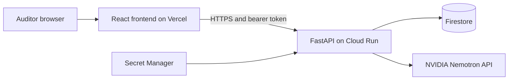
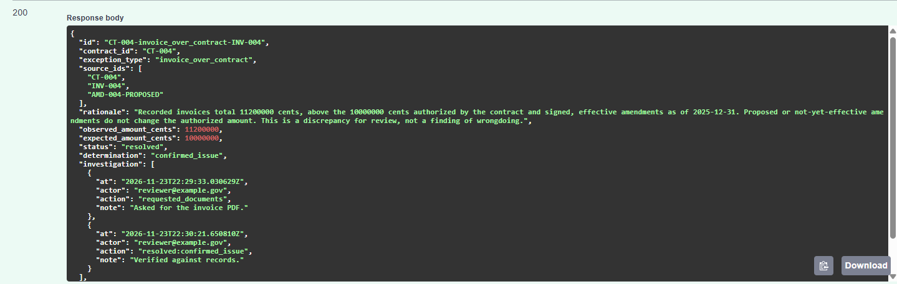
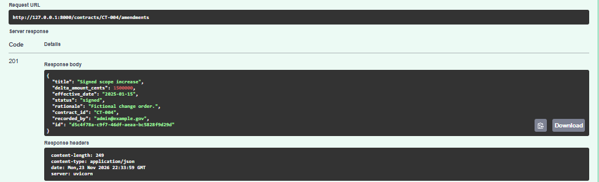
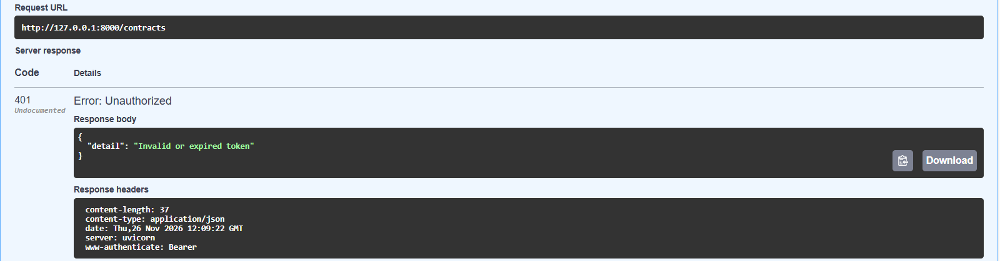
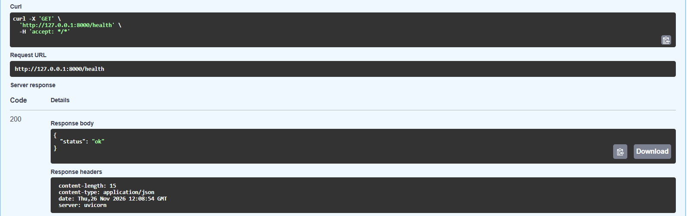
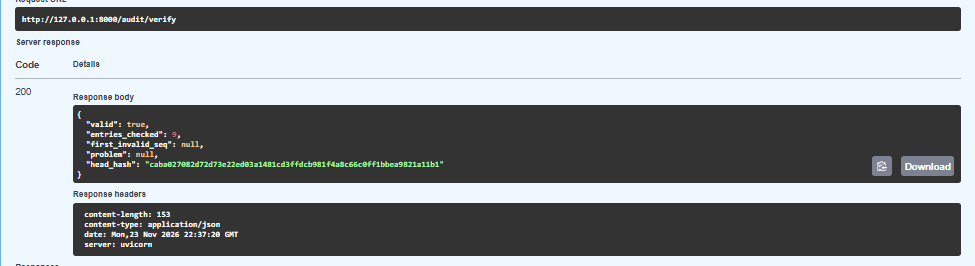
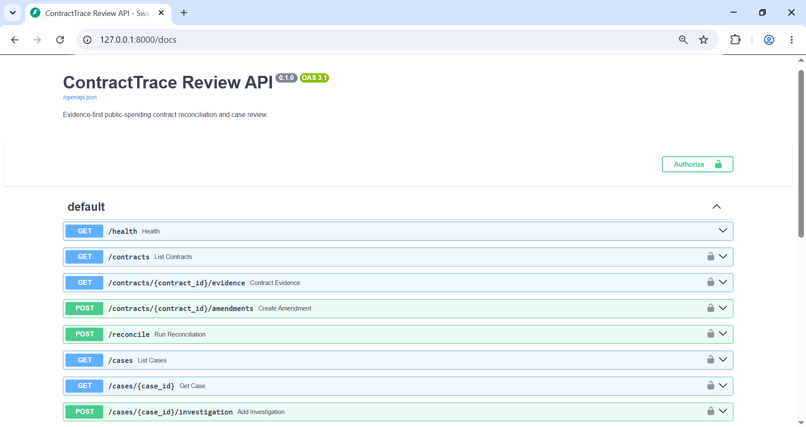

# ContractTrace

Evidence first public spending oversight, aligned with UN SDG 16, Target 16.6 (effective, accountable and transparent institutions).

> A flag is a signal to investigate, never a final finding.

ContractTrace links contracts, amendments, invoices and payments into one reviewable record, raises explainable flags, and keeps a tamper evident record of every human decision. All data in this project is fictional.

* Frontend demo: https://contracttrace.vercel.app/
* API: FastAPI service on Google Cloud Run (deployment steps in `backend/README.md`)
* Repository layout: `backend/` (FastAPI), `frontend/` (React and Vite), `firestore.rules`, `firebase.json`, `.github/workflows/`, `docs/`

## Team

| Member | Area |
| --- | --- |
| Collins | Review workflow, case lifecycle, fictional dataset, four eyes principle |
| Arther | Backend services, reconciliation engine, NVIDIA integration |
| Urvashi | Reviewer case schema, frontend dashboard, Docker and Cloud Run deployment |
| Zayyan | Security: access control, audit log, secrets, tests, documentation |

## How it works



1. Reconciliation compares contracts, signed amendments, invoices and payments and opens a review case for each discrepancy.
2. A reviewer investigates, adds notes, and confirms the issue or dismisses it with a written rationale.
3. Every case opening, note, decision and amendment is written to a hash chained audit log.
4. An AI summary is available as a neutral aid. It cannot raise, close or edit a case.

The web interface is covered in the project demo deck, so this document focuses on the data model, security and the backend.

## Data model

The data design (WBS 2.3) has five entities stored as Firestore documents: Contracts, Amendments, Invoices, Payments and AuditFlags. Reviewer assignment, timestamps, decisions and status history live inside AuditFlags.


| Relationship | Cardinality | Implemented by |
| --- | --- | --- |
| Contract to Amendments, Invoices, Payments, AuditFlags | 1 to 0..N | `contract_id` on each child |
| Invoice to Payments | 1 to 0..N | `invoice_id` on Payments |
| Amendment, Invoice or Payment to AuditFlags | 0..N trigger records | `trigger_entity_type` and `trigger_entity_id` |
| Amendment to AuditFlags resolution | 0..N | `resolved_by_amendment_id` |

Firestore does not enforce foreign keys, so references and allowed values are validated by the backend. Money is handled with exact arithmetic, never floating point.

How the running backend maps to this design: the reviewer case is stored in the `cases` collection, and the tamper evident log is stored separately in `audit_log` (with `audit_head` holding the newest entry for transactions). Amounts are integer cents. The diagram is the design reference, and a few names differ in code. For example, the reviewer case is `AuditFlags` in the diagram and `cases` in the API.

## Review rules

The product brief defines three rules. This table shows where each one runs today.

| Rule | Meaning | Backend | Frontend demo |
| --- | --- | --- | --- |
| 1 Cap overrun | Cumulative invoices exceed the authorized amount | Yes (`invoice_over_contract`) | Yes |
| 2 Temporal | Payment before contract start or milestone approval | Yes | Yes |
| 3 Amendment resolution | A signed, effective amendment raises the cap and the flag clears | Yes, the flag no longer appears on the next reconciliation and the original case stays in history | Yes |

The backend also raises `payment_mismatch` (payments do not equal the invoice) and `unmatched_payment` (a payment with no matching invoice). Proposed or not yet effective amendments never change the authorized amount.

The ten fictional contracts with their invoices, payments and amendments are loaded from `backend/app/seed.py` for the API and from `frontend/src/data/mockData.js` for the frontend demo. The two datasets use different contract ids (`CT-001` to `CT-010` and `CNT-2026-001` to `CNT-2026-010`).

## Access control

Every endpoint except `/health` needs `Authorization: Bearer <token>`. The token carries the user (`sub`), a role and an expiry, signed with `AUTH_JWT_SECRET`.

| Permission | Viewer | Reviewer | Admin |
| --- | --- | --- | --- |
| Read contracts and cases | Yes | Yes | Yes |
| Read the audit log | No | Yes | Yes |
| Run reconciliation | No | Yes | Yes |
| Investigate and resolve cases | No | Yes | No |
| Request AI analysis | No | Yes | No |
| Record amendments | No | No | Yes |

* Separation of duties: admins record amendments, reviewers resolve cases, never both. An amendment can clear a flag, so one person should not control both steps.
* The person recorded on every action comes from the verified token. The `actor` field in request bodies is ignored.
* Responses: 401 for a missing or invalid token, 403 when the role lacks the permission, 503 when no signing secret is configured (the API fails closed).
* Refused write attempts are recorded in the audit log as `permission_denied`.
* With `APP_ENV=production` the `/docs` and `/openapi.json` pages are hidden.

### Evidence from a local run

A viewer tries to resolve a case and is refused:


A reviewer resolves the case, with notes and the reviewer's identity recorded:



An admin records the amendment, and `recorded_by` comes from the token:



A request with an invalid or expired token is rejected, and the health check stays public:





## Audit log

Entries are stored in the `audit_log` collection. Each entry holds the hash of the previous entry and a hash of its own contents, so editing, reordering or removing an entry breaks the chain.

| Field | Meaning |
| --- | --- |
| `seq` | Position in the log, starting at 1 with no gaps |
| `at` | UTC timestamp |
| `actor` | User id from the token, or `system:reconciliation` |
| `action` | `case_opened`, `investigation_note_added`, `case_resolved`, `amendment_recorded`, `permission_denied` |
| `target_type`, `target_id` | What the action was about |
| `details` | Event facts, including role and the reviewer's note |
| `prev_hash`, `hash` | SHA 256 chain links |

`GET /audit` lists entries (filter with `target_id`). `GET /audit/verify` recomputes the whole chain and reports whether it is valid, how many entries were checked, and the first broken entry if any. Sequence numbers are claimed in a Firestore transaction (`append_chained` in `store.py`), so several Cloud Run instances cannot create duplicates.



## Secrets and cloud setup

* Google Cloud project `contracttrace-gclp-2026`, Firestore location Africa 1 (`africa-south1`).
* Secret Manager holds `AUTH_JWT_SECRET`, `NVIDIA_API_KEY` and `NVIDIA_MODEL`. They reach Cloud Run as environment variables. No key files and no secrets in GitHub.
* The runtime service account `contracttrace-api` has `roles/secretmanager.secretAccessor` on those three secrets and `roles/datastore.user` on the project, and nothing else.
* `firestore.rules` denies all direct browser and mobile access. The backend service account bypasses these rules by design, so its access is controlled by IAM.
* Cloud Audit Logs record who created and changed secrets, and Data Access audit logs are on for Secret Manager.


## Advisory AI

`POST /cases/{case_id}/ai-analysis` sends the case record to the NVIDIA chat completions API and returns a neutral JSON summary with `summary`, `evidence_observations` and `limitation`. The prompt forbids accusations and inference of intent. The model is set by the `NVIDIA_MODEL` secret (`nvidia/nemotron-3.5-super-vl-120b-a12b`). The AI output is a draft for reviewers. Official amounts come from the reconciliation engine.

## API endpoints

| Method | Path | Permission |
| --- | --- | --- |
| GET | `/health` | none |
| GET | `/contracts` | `contracts:read` |
| GET | `/contracts/{id}/evidence` | `contracts:read` |
| POST | `/contracts/{id}/amendments` | `amendment:record` |
| POST | `/reconcile` | `reconcile:run` |
| GET | `/cases`, `/cases/{id}` | `cases:read` |
| POST | `/cases/{id}/investigation` | `case:investigate` |
| POST | `/cases/{id}/resolve` | `case:resolve` |
| POST | `/cases/{id}/ai-analysis` | `ai:analyze` |
| GET | `/audit`, `/audit/verify` | `audit:read` |



## Run it locally

Backend (Python 3.11 or newer):

```powershell
cd backend
python -m venv .venv
.venv\Scripts\Activate.ps1
pip install -r requirements.txt
$env:AUTH_JWT_SECRET = python -c "import secrets; print(secrets.token_urlsafe(48))"
python -m uvicorn app.main:app --reload
```

In a second window with the same `AUTH_JWT_SECRET` set, make a test token with `python scripts/issue_dev_token.py reviewer reviewer@example.gov`, then open http://127.0.0.1:8000/docs and click Authorize. Use only a throwaway secret locally. The real secret lives in Secret Manager.

Frontend:

```bash
cd frontend
npm install
npm run dev
```

It opens at http://localhost:5173 and runs on a bundled demo dataset. To use the API, set `VITE_API_BASE_URL` in `frontend/.env`.

## Tests

```bash
cd backend
python -m pytest
```

47 tests: 32 for authentication and permissions, 11 for the audit log (including concurrent appends and tamper detection) and 4 for the API. CI runs them on every push that touches `backend/`. Run `python -m pytest` to confirm the current count.

## Known limits and next steps

* The audit log is tamper evident, not immutable. Changes to old entries are exposed by verification, but the backend can still write to Firestore. Cloud Audit Logs add a platform level record.
* A chain cannot show that its newest entries were removed. Copy the head hash from `GET /audit/verify` somewhere outside the database after each review cycle.
* The frontend login is a demo picker and the deployed frontend uses bundled data. Moving to Firebase Auth or Identity Platform, with the role as a custom claim, is the planned next step.
* Data Access audit logs are on for Secret Manager. Turning them on for Firestore (Cloud Datastore API) is the remaining logging step.
* Successful reconciliation runs and AI requests are not logged yet, only the cases they create and refused attempts.
* Data is fictional. A real pilot would need real records, for example parsed from contract PDFs.

## Data notice

All contracts, vendors, invoices and payments are fictional and created for this project.
