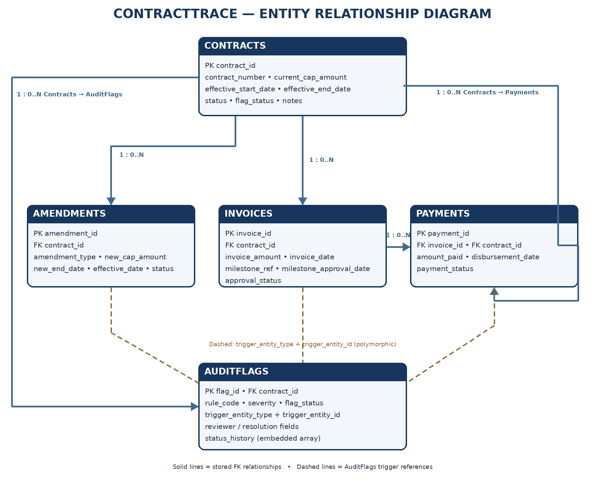
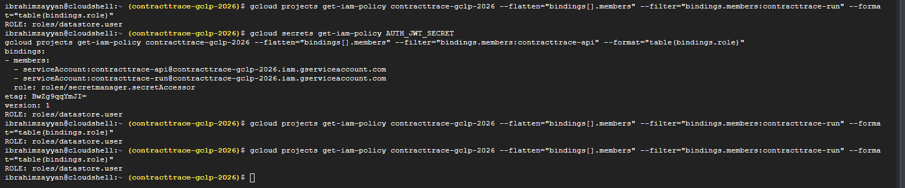
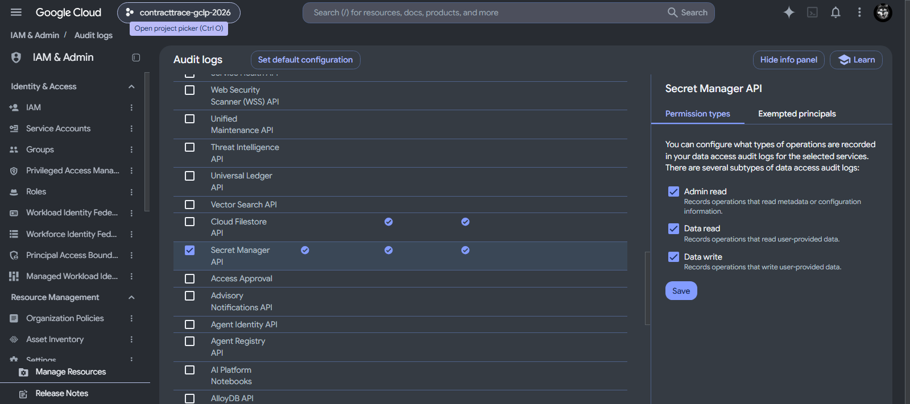
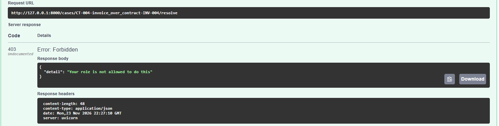

# ContractTrace

Evidence-first public-spending oversight and audit platform (UN SDG target 16.6). ContractTrace connects contracts, amendments, invoices, and treasury payments, then surfaces reconciliation exceptions so an accredited auditor can review each one.

> A flag is a signal to investigate, never a final finding of wrongdoing.

ContractTrace links contracts, amendments, invoices and payments into one reviewable record, raises explainable flags, and keeps a tamper evident record of every human decision. All data in this project is fictional.

* Frontend demo: https://contracttrace.vercel.app/
* API: FastAPI service on Google Cloud Run (deployment steps in `backend/README.md`)
* Repository layout: `backend/` (FastAPI), `frontend/` (React and Vite), `firestore.rules`, `firebase.json`, `.github/workflows/`, `docs/`

## Team

| Member | Area |
| --- | --- |
| Collins | Review workflow, case lifecycle, fictional dataset, four eyes principle |
| Arther | Backend services, reconciliation engine, NVIDIA integration |
| Urvashi | Reviewer case schema, frontend dashboard, Docker and Cloud Run deployment |
| Zayyan | Security: access control, audit log, secrets, tests, documentation |

## Architecture

- **Frontend** — a React 19 dashboard built with Vite and Tailwind. It renders six views (Overview, Reviewer Workbench, Contracts Explorer, Audit Flags, Operational Analytics, Investigation History). A single data provider ([dataContext.jsx](frontend/src/api/dataContext.jsx)) either loads live records from the API or falls back to a bundled dataset, and [adapter.js](frontend/src/api/adapter.js) translates backend records into the shapes the views expect.
- **Backend** — a FastAPI service. `POST /reconcile` runs deterministic rules over the stored records and opens review cases; auditors investigate and resolve those cases. Data lives in Firestore in production and in memory for local dev and tests.
- **Audit log** — append-only. Each entry stores the hash of the previous entry plus a hash of its own contents, so any edit or deletion breaks the chain (`GET /audit/verify`).
- **AI (optional)** — `POST /cases/{id}/ai-analysis` calls NVIDIA's OpenAI-compatible API to draft a neutral case summary. The Reviewer Workbench exposes it as an **Analyze with AI** action on the selected case (live mode only, reviewer role). Missing credentials or provider failures are returned explicitly.
- **Deployment** — the API runs as a container on Cloud Run, exposed through Firebase Hosting (`firebase.json` rewrites `**` to the `contracttrace-api` service); Firestore rules deny all direct client access. The dashboard deploys separately to Vercel.

## Deterministic rules

Reconciliation is arithmetic, not judgement. The backend raises three exception types, and the dashboard maps them onto its rule catalog:

| Exception type | Dashboard rule | Condition |
| --- | --- | --- |
| `invoice_over_contract` | Rule 1 · Cap Overrun | Cumulative invoices exceed the authorized cap + signed, effective amendments |
| `payment_mismatch` | Rule 4 · Payment Mismatch | Linked payments for an invoice do not total the invoice amount |
| `unmatched_payment` | Rule 5 · Unmatched Payment | A payment has no invoice under the same contract |

The bundled frontend dataset additionally demonstrates **Rule 2** (payment executed before the contract start date) and **Rule 3** (an executed amendment raises the cap and clears an overrun flag while the original case stays in history). Those two are presentation-only: they have no backend counterpart.

Both sides now share one dataset. The API seeds from [demo_dataset.json](backend/app/demo_dataset.json), which `node scripts/export-demo-dataset.mjs` generates from [mockData.js](frontend/src/data/mockData.js), so the live API and the offline dashboard show the same contracts. Seeding writes only the raw contracts, amendments, invoices, and payments — every case is still re-derived by `POST /reconcile`. Blocked disbursements are not exported (a payment that was never released is not a payment record), so their invoices appear as `payment_mismatch` cases live. Proposed or not-yet-effective amendments never change the authorized amount.

Amounts are stored and computed in **integer cents** in the backend and converted to currency units for display.

## Data model

The data design (WBS 2.3) has five entities stored as Firestore documents: Contracts, Amendments, Invoices, Payments and AuditFlags. Reviewer assignment, timestamps, decisions and status history live inside AuditFlags.



| Relationship | Cardinality | Implemented by |
| --- | --- | --- |
| Contract to Amendments, Invoices, Payments, AuditFlags | 1 to 0..N | `contract_id` on each child |
| Invoice to Payments | 1 to 0..N | `invoice_id` on Payments |
| Amendment, Invoice or Payment to AuditFlags | 0..N trigger records | `trigger_entity_type` and `trigger_entity_id` |
| Amendment to AuditFlags resolution | 0..N | `resolved_by_amendment_id` |

Firestore does not enforce foreign keys, so references and allowed values are validated by the backend. Money is handled with exact arithmetic, never floating point.

How the running backend maps to this design: the reviewer case is stored in the `cases` collection, and the tamper evident log is stored separately in `audit_log` (with `audit_head` holding the newest entry for transactions). Amounts are integer cents. The diagram is the design reference, and a few names differ in code. For example, the reviewer case is `AuditFlags` in the diagram and `cases` in the API.

## Review rules

The product brief defines three rules. This table shows where each one runs today.

| Rule | Meaning | Backend | Frontend demo |
| --- | --- | --- | --- |
| 1 Cap overrun | Cumulative invoices exceed the authorized amount | Yes (`invoice_over_contract`) | Yes |
| 2 Temporal | Payment before contract start or milestone approval | Yes | Yes |
| 3 Amendment resolution | A signed, effective amendment raises the cap and the flag clears | Yes, the flag no longer appears on the next reconciliation and the original case stays in history | Yes |

The backend also raises `payment_mismatch` (payments do not equal the invoice) and `unmatched_payment` (a payment with no matching invoice). Proposed or not yet effective amendments never change the authorized amount.

The ten fictional contracts with their invoices, payments and amendments are loaded from `backend/app/seed.py` for the API and from `frontend/src/data/mockData.js` for the frontend demo. The two datasets use different contract ids (`CT-001` to `CT-010` and `CNT-2026-001` to `CNT-2026-010`).

## Access control

Every endpoint except `/health` needs `Authorization: Bearer <token>`. The token carries the user (`sub`), a role and an expiry, signed with `AUTH_JWT_SECRET`.

| Permission | Viewer | Reviewer | Admin |
| --- | --- | --- | --- |
| Read contracts and cases | Yes | Yes | Yes |
| Read the audit log | No | Yes | Yes |
| Run reconciliation | No | Yes | Yes |
| Investigate and resolve cases | No | Yes | No |
| Request AI analysis | No | Yes | No |
| Record amendments | No | No | Yes |

* Separation of duties: admins record amendments, reviewers resolve cases, never both. An amendment can clear a flag, so one person should not control both steps.
* The person recorded on every action comes from the verified token. The `actor` field in request bodies is ignored.
* Responses: 401 for a missing or invalid token, 403 when the role lacks the permission, 503 when no signing secret is configured (the API fails closed).
* Refused write attempts are recorded in the audit log as `permission_denied`.
* With `APP_ENV=production` the `/docs` and `/openapi.json` pages are hidden.

## Quick start

### 1. Backend

```bash
cd backend
python -m venv .venv
source .venv/bin/activate
pip install -r requirements.txt
export AUTH_JWT_SECRET="dev-secret-that-is-at-least-32-characters-long"
uvicorn app.main:app --reload
```

Runs at `http://127.0.0.1:8000` with an in-memory store seeded with the shared demo dataset (`CNT-2026-001`…`CNT-2026-010`, the same contracts the dashboard shows offline). Interactive docs are at `/docs`. The app loads `backend/.env` automatically if present.

### 2. Frontend

```bash
cd frontend
npm install
npm run dev
```

It opens at http://localhost:5173 and runs on a bundled demo dataset. To use the API, set `VITE_API_BASE_URL` in `frontend/.env`.

### 3. Connect the two

```bash
cd frontend
cp .env.example .env          # sets VITE_API_BASE_URL=http://localhost:8000
npm run dev
```

With `VITE_API_BASE_URL` set, the dashboard shows the auditor sign-in screen, obtains a bearer token from `POST /auth/dev-login`, and loads live data. If the API is unreachable it falls back to the bundled dataset and shows a banner with a retry action.

### Persisting auditor sign-offs

Auditor determinations (`confirmed_issue` / `dismissed`) are written to the backend's `cases` collection and appended to the hash-chained `audit_log`, so they survive page reloads. For that to happen:

- The frontend must run with `VITE_API_BASE_URL` set (see `frontend/.env.example`), otherwise it stays in mock mode and sign-offs live only in temporary React state, resetting on reload.
- The backend must run with `STORAGE_BACKEND=firestore` so cases are written to Firestore rather than the in-memory store (which resets when the server restarts).
- In production, run with `SEED_DEMO_DATA=false` so startup seeding does not overwrite live records (seeding only writes missing contracts, amendments, invoices, and payments — never cases — but set it to `false` to be safe).

## Configuration

### Backend (`backend/.env`)

| Variable | Default | Purpose |
| --- | --- | --- |
| `AUTH_JWT_SECRET` | – | JWT signing secret, at least 32 characters. Without it the API returns 503 instead of running open. |
| `APP_ENV` | `development` | `production` hides `/docs` and `/openapi.json` and disables `POST /auth/dev-login`. |
| `STORAGE_BACKEND` | `memory` | `memory` or `firestore`. |
| `GOOGLE_CLOUD_PROJECT` | – | Required when using Firestore. |
| `SEED_DEMO_DATA` | `true` for memory | Seeds the shared demo dataset from `backend/app/demo_dataset.json` on startup. |
| `CORS_ALLOW_ORIGINS` | local Vite dev server | Comma-separated browser origins allowed to call the API. |
| `NVIDIA_API_KEY` / `NVIDIA_MODEL` | – | Enable AI case analysis. |

### Frontend (`frontend/.env`)

| Variable | Purpose |
| --- | --- |
| `VITE_API_BASE_URL` | Base URL of the FastAPI backend. Unset = bundled demo dataset only. |

## API endpoints

| Method | Path | Permission |
| --- | --- | --- |
| GET | `/health` | none |
| GET | `/contracts` | `contracts:read` |
| GET | `/contracts/{id}/evidence` | `contracts:read` |
| POST | `/contracts/{id}/amendments` | `amendment:record` |
| POST | `/reconcile` | `reconcile:run` |
| GET | `/cases`, `/cases/{id}` | `cases:read` |
| POST | `/cases/{id}/investigation` | `case:investigate` |
| POST | `/cases/{id}/resolve` | `case:resolve` |
| POST | `/cases/{id}/ai-analysis` | `ai:analyze` |
| GET | `/audit`, `/audit/verify` | `audit:read` |


| Method | Path | Notes |
| --- | --- | --- |
| `GET` | `/health` | Unauthenticated. |
| `POST` | `/auth/dev-login` | Development only; disabled when `APP_ENV=production`. |
| `GET` | `/contracts`, `/contracts/{id}/evidence` | Contract list and linked amendments, invoices, payments. |
| `POST` | `/contracts/{id}/amendments` | Record an amendment (admin only). |
| `POST` | `/reconcile?as_of=YYYY-MM-DD` | Run deterministic rules and open cases. |
| `GET` | `/cases`, `/cases/{id}` | Review cases. |
| `POST` | `/cases/{id}/investigation` | Add an investigation note. |
| `POST` | `/cases/{id}/resolve` | Record `confirmed_issue` or `dismissed` with a note. |
| `POST` | `/cases/{id}/ai-analysis` | Optional NVIDIA case summary. |
| `GET` | `/audit`, `/audit/verify` | List the audit chain and verify its integrity. |

## Audit log

Entries are stored in the `audit_log` collection. Each entry holds the hash of the previous entry and a hash of its own contents, so editing, reordering or removing an entry breaks the chain.

| Field | Meaning |
| --- | --- |
| `seq` | Position in the log, starting at 1 with no gaps |
| `at` | UTC timestamp |
| `actor` | User id from the token, or `system:reconciliation` |
| `action` | `case_opened`, `investigation_note_added`, `case_resolved`, `amendment_recorded`, `permission_denied` |
| `target_type`, `target_id` | What the action was about |
| `details` | Event facts, including role and the reviewer's note |
| `prev_hash`, `hash` | SHA 256 chain links |

`GET /audit` lists entries (filter with `target_id`). `GET /audit/verify` recomputes the whole chain and reports whether it is valid, how many entries were checked, and the first broken entry if any. Sequence numbers are claimed in a Firestore transaction (`append_chained` in `store.py`), so several Cloud Run instances cannot create duplicates.


## Secrets and cloud setup

* Google Cloud project `contracttrace-gclp-2026`, Firestore location Africa 1 (`africa-south1`).
* Secret Manager holds `AUTH_JWT_SECRET`, `NVIDIA_API_KEY` and `NVIDIA_MODEL`. They reach Cloud Run as environment variables. No key files and no secrets in GitHub.
* The runtime service account `contracttrace-api` has `roles/secretmanager.secretAccessor` on those three secrets and `roles/datastore.user` on the project, and nothing else.
* `firestore.rules` denies all direct browser and mobile access. The backend service account bypasses these rules by design, so its access is controlled by IAM.
* Cloud Audit Logs record who created and changed secrets, and Data Access audit logs are on for Secret Manager.





## Advisory AI

`POST /cases/{case_id}/ai-analysis` sends the case record to the NVIDIA chat completions API and returns a neutral JSON summary with `summary`, `evidence_observations` and `limitation`. The prompt forbids accusations and inference of intent. The model is set by the `NVIDIA_MODEL` secret (`nvidia/nemotron-3.5-super-vl-120b-a12b`). The AI output is a draft for reviewers. Official amounts come from the reconciliation engine.

## Run it locally

Backend (Python 3.11 or newer):

```powershell
cd backend
python -m venv .venv
.venv\Scripts\Activate.ps1
pip install -r requirements.txt
$env:AUTH_JWT_SECRET = python -c "import secrets; print(secrets.token_urlsafe(48))"
python -m uvicorn app.main:app --reload
```

In a second window with the same `AUTH_JWT_SECRET` set, make a test token with `python scripts/issue_dev_token.py reviewer reviewer@example.gov`, then open http://127.0.0.1:8000/docs and click Authorize. Use only a throwaway secret locally. The real secret lives in Secret Manager.

## Testing and CI

```bash
cd backend && pytest          # 58 tests, in-memory store, no cloud credentials
cd frontend && npm run build  # production build
```

47 tests: 32 for authentication and permissions, 11 for the audit log (including concurrent appends and tamper detection) and 4 for the API. CI runs them on every push that touches `backend/`. Run `python -m pytest` to confirm the current count.

GitHub Actions ([backend-ci.yml](.github/workflows/backend-ci.yml)) installs `backend/requirements.txt`, runs the tests, and compiles the sources whenever `backend/**` changes. Continuous deployment is not configured.

## Known limits and next steps

* The audit log is tamper evident, not immutable. Changes to old entries are exposed by verification, but the backend can still write to Firestore. Cloud Audit Logs add a platform level record.
* A chain cannot show that its newest entries were removed. Copy the head hash from `GET /audit/verify` somewhere outside the database after each review cycle.
* The frontend login is a demo picker and the deployed frontend uses bundled data. Moving to Firebase Auth or Identity Platform, with the role as a custom claim, is the planned next step.
* Data Access audit logs are on for Secret Manager. Turning them on for Firestore (Cloud Datastore API) is the remaining logging step.
* Successful reconciliation runs and AI requests are not logged yet, only the cases they create and refused attempts.
* Data is fictional. A real pilot would need real records, for example parsed from contract PDFs.

## Deployment

- **Backend** — build the `backend/Dockerfile` to Cloud Run and inject `AUTH_JWT_SECRET` (and `NVIDIA_API_KEY` if used) from Secret Manager. Use `STORAGE_BACKEND=firestore`, `SEED_DEMO_DATA=false`, and `APP_ENV=production`. Firebase Hosting proxies the public domain to the service.
- **Frontend** — build with Vite and deploy to Vercel (`frontend/vercel.json` handles SPA rewrites). Set `VITE_API_BASE_URL` to the deployed API and add the frontend origin to `CORS_ALLOW_ORIGINS` on the backend.

## Data notice

All contracts, vendors, invoices and payments are fictional and created for this project.

### Evidence from a local run

A viewer tries to resolve a case and is refused:



A reviewer resolves the case, with notes and the reviewer's identity recorded:


An admin records the amendment, and `recorded_by` comes from the token:


A request with an invalid or expired token is rejected, and the health check stays public:


